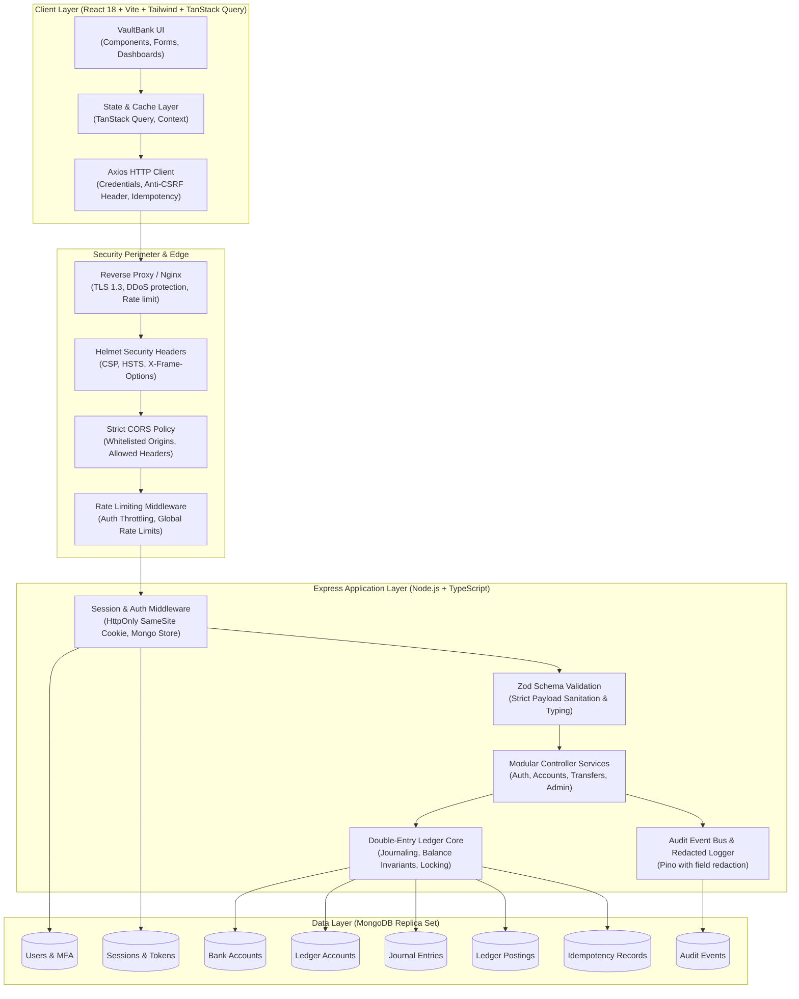
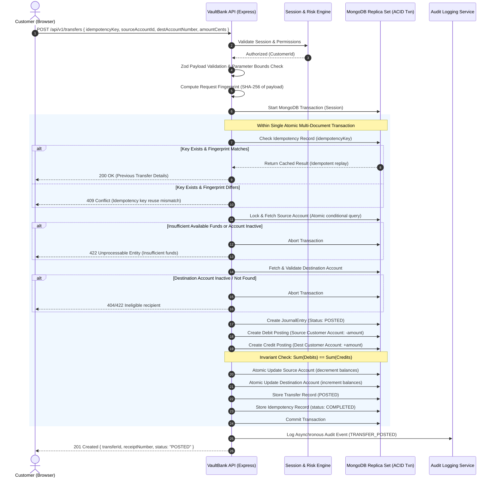

# VaultBank — Enterprise Full-Stack Digital Banking Platform

[](https://github.com/vaultbank/vaultbank)
[](https://nodejs.org)
[](https://react.dev)
[](https://www.typescriptlang.org)
[](https://www.mongodb.com)
[](LICENSE)

VaultBank is a production-grade full-stack digital banking platform engineered on the MERN stack with strict financial integrity, double-entry general ledger accounting, multi-document ACID transaction guarantees, Argon2id cryptography, and dual-control administrative governance.

> [!NOTE]
> **Educational & Portfolio System**: VaultBank operates entirely with simulated funds and simulated bank accounts. It does not connect to real central clearinghouses or real financial networks.

---

## Architecture & Financial Core Invariants

1. **Strict Double-Entry Equilibrium**: Every posted financial transaction is modeled as an immutable `JournalEntry` containing at least two `LedgerPosting` legs (Debit and Credit).
   $$\sum \text{Debits} \equiv \sum \text{Credits}$$
2. **Integer Minor Currency Units**: All balances, transfers, and postings are stored and manipulated as integers in minor currency units (e.g. cents, paise). Floating-point arithmetic is strictly prohibited in authoritative accounting pathways.
3. **Multi-Document ACID Transactions**: Transfer execution, balance decrements, and idempotency updates occur within atomic MongoDB sessions (`readConcern: majority`, `writeConcern: majority`).
4. **Authoritative Ledger vs Derived Cache**: The `LedgerPosting` collection is the immutable source of truth. Cached customer balances (`availableBalanceCents` and `ledgerBalanceCents`) are verified via an explicit reconciliation engine.
5. **Maker-Checker Dual Control**: Administrative adjustments cannot be approved by the staff member who initiated them. Separation of duties is enforced at the controller and database layer.
6. **Defense-in-Depth Cryptography**: Argon2id password hashing, single-use token hashes in database, HttpOnly SameSite session cookies, Anti-CSRF headers (`X-VaultBank-CSRF`), and progressive lockout throttling.

---

## System Architecture Diagram



---

## Transaction & Idempotency Flow Diagram



---

## Pre-Configured Demo Accounts

For educational evaluation and local exploration, the database seed script provisions clearly labeled test accounts:

| Role | Email Address | Password | Pre-Funded Balance |
|---|---|---|---|
| **CUSTOMER** | `customer1@vaultbank.test` | `CustomerPass123!` | Checking: \$12,500.00 \| Savings: \$45,000.00 |
| **CUSTOMER** | `customer2@vaultbank.test` | `CustomerPass123!` | Checking: \$8,200.00 \| Savings: \$15,000.00 |
| **ADMIN** | `admin@vaultbank.test` | `VaultAdmin123!` | System Administrator |
| **COMPLIANCE** | `compliance@vaultbank.test` | `VaultCompliance123!` | Compliance Officer (Maker-Checker) |
| **SUPPORT** | `support@vaultbank.test` | `VaultSupport123!` | Customer Operations Support |

> [!TIP]
> On the web login screen (`/login`), click any **One-Click Demo Accounts** pill to instantly auto-fill credentials for fast testing.

---

## Quickstart & Local Setup

### Prerequisites
- Node.js 20 or higher
- npm 10 or higher
- Docker & Docker Compose (optional for containerized deployment)

### 1. Installation
Clone the repository and install dependencies across all workspaces:
```bash
git clone https://github.com/vaultbank/vaultbank.git
cd vaultbank
npm install
```

### 2. Environment Configuration
Copy `.env.example` to `server/.env`:
```bash
cp .env.example server/.env
```

### 3. Build Monorepo Workspaces
```bash
npm run build
```

### 4. Run Automated Test Suite
Run the 16+ unit, integration, and security verification tests (uses isolated in-memory MongoDB):
```bash
npm run test:server
```

### 5. Start Development Servers
In separate terminal tabs:

**Terminal 1 — Backend API Server (port 5000):**
```bash
npm run dev --workspace=@vaultbank/server
```

**Terminal 2 — Frontend Client (port 5173):**
```bash
npm run dev --workspace=@vaultbank/client
```

Navigate to `http://localhost:5173` in your browser.

---

## Running with Docker Compose

To run the entire system with an active MongoDB replica set container:
```bash
docker compose up --build
```
This boots:
- `vaultbank-mongo`: Single-node replica set `rs0` on port 27017
- `vaultbank-mongo-init`: Automatically initiates replica set
- `vaultbank-server`: Node.js Express API on port 5000
- `vaultbank-client`: Nginx serving optimized React SPA on port 5173

---

## API Documentation (`/api/v1`)

All mutating requests require `Content-Type: application/json` and `X-VaultBank-CSRF` header.

### Authentication
- `POST /api/v1/auth/register` — Register new customer profile and generate initial accounts.
- `POST /api/v1/auth/login` — Authenticate credentials with progressive lockout and optional TOTP MFA.
- `POST /api/v1/auth/verify-email` — Single-use verification token confirmation.
- `POST /api/v1/auth/logout` — Revoke active session and clear cookie.
- `POST /api/v1/auth/logout-all` — Revoke all active sessions across all devices.
- `POST /api/v1/auth/forgot-password` — Generate single-use password reset token.
- `POST /api/v1/auth/reset-password` — Set new password using token and revoke existing sessions.
- `POST /api/v1/auth/mfa/setup` — Generate TOTP secret, QR code data URL, and 8 emergency backup codes.
- `POST /api/v1/auth/mfa/verify` — Confirm TOTP code and enable MFA on account.
- `GET /api/v1/auth/sessions` — List active persistent sessions.
- `DELETE /api/v1/auth/sessions/:sessionId` — Revoke specific remote session.

### Depository Accounts
- `GET /api/v1/accounts` — List authorized user's bank accounts with available and ledger balances.
- `POST /api/v1/accounts` — Open a new checking or savings account with linked ledger account.
- `GET /api/v1/accounts/lookup/:accountNumber` — Validate recipient account number and retrieve masked name.
- `GET /api/v1/accounts/:accountId` — Retrieve specific account details.
- `GET /api/v1/accounts/:accountId/transactions` — Paginated immutable ledger postings.
- `GET /api/v1/accounts/:accountId/export-csv` — Download transaction history as standard CSV statement.
- `POST /api/v1/accounts/simulate-deposit` — Simulate educational deposit from central vault asset.
- `POST /api/v1/accounts/simulate-withdrawal` — Simulate educational withdrawal.

### Transfers & Payments
- `POST /api/v1/transfers` — Execute internal transfer with idempotency key, velocity check, and re-authentication for high-value transfers (≥ \$5,000.00).
- `GET /api/v1/transfers` — Retrieve user's sent and received transfer history.
- `GET /api/v1/transfers/:transferId` — Retrieve specific transfer and receipt data.

### Administration & Compliance (`ADMIN`, `COMPLIANCE`, `SUPPORT`)
- `GET /api/v1/admin/users` — Customer directory with role, status, and search.
- `PATCH /api/v1/admin/users/:userId/status` — Modify user status (`ACTIVE`, `LOCKED`, `SUSPENDED`) with mandatory audit reason.
- `GET /api/v1/admin/transactions` — Platform-wide transaction surveillance with risk scores.
- `GET /api/v1/admin/audit-events` — Immutable chronological audit log viewer.
- `GET /api/v1/admin/reconcile/:accountId` — Calculate real-time ledger postings sum and compare with cached balance.
- `GET /api/v1/admin/adjustments` — Maker-Checker pending adjustment approval queue.
- `POST /api/v1/admin/adjustments` — Maker initiates balance adjustment proposal.
- `POST /api/v1/admin/adjustments/:id/review` — Checker reviews, approves, or rejects adjustment. **Maker is strictly barred from self-approving.**

---

## STRIDE Threat Model & Mitigations

| Threat Category | Potential Vulnerability | VaultBank Architectural Mitigation |
|---|---|---|
| **Spoofing** | Credential stuffing, brute-force, token forgery | Argon2id hashing with unique salts; progressive lockout after 5 failures; opaque persistent sessions in MongoDB; TOTP 2FA. |
| **Tampering** | Double spending, balance manipulation, client tampering | Multi-document ACID transactions with atomic conditional queries; balances derived solely server-side; immutable ledger postings. |
| **Repudiation** | Denying transaction execution | Immutable `AuditEvent` records recording user ID, IP, user-agent, cryptographic hash, and UUID receipt number. |
| **Information Disclosure** | Credential leakage in logs or responses | Automatic Pino field redaction (`password`, `token`, `mfaSecret`); generic error messages on auth failure; masked account numbers. |
| **Denial of Service** | Resource exhaustion on transfer or auth routes | Tiered rate limiting (`express-rate-limit`); 15KB body size limit; strict query limits. |
| **Elevation of Privilege** | BOLA / IDOR / Admin Bypass | Server-side role authorization (`requireRole`); client role payloads discarded; ownership checks on all accounts. |
| **CSRF** | Cross-site unauthorized transfer submission | Custom `X-VaultBank-CSRF` header validation for all mutating operations; SameSite cookie policy. |

---

## Known Educational Limitations & Assumptions

1. **Simulated Money Only**: No connection to real-world ACH, Fedwire, SEPA, or SWIFT clearing networks.
2. **Single-Currency Ledger**: The default deployment operates in USD. While schema supports multi-currency codes, cross-currency automated FX foreign exchange pricing curves are not integrated.
3. **In-Memory Testing Replica Set**: Vitest tests execute against an in-memory MongoDB runner. For production high-availability, MongoDB Atlas or a 3-node replica set cluster is required.

